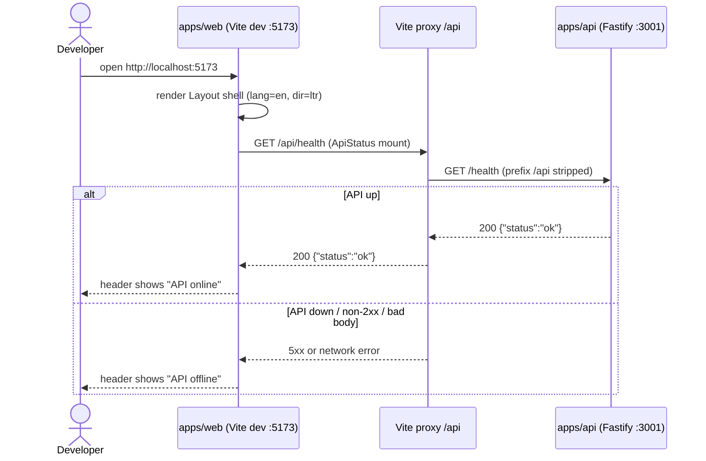

## At a Glance

**What's changing:** The Agent Workspace repo already has a working React web app. It does not have a backend, tests or CI. This change adds a small Node API that answers `/health` and turns the repo into one npm workspace, so a single install covers both apps. The web shell header gets a live "API online / offline" indicator. A CI workflow runs lint, typecheck, build and the tests on every push and pull request.

**Solutions:** 1 solution → 1 PR

- **solution** `default` — bootstrap the API, connect the web shell to it, and add CI and docs; repos: agent-workspace; prs: 1

**Watch out for:**
- The per-app lockfile `apps/web/package-lock.json` is replaced by one root `package-lock.json`. Every install now runs from the repo root.
- The web package versions are very new (Vite 8, TypeScript 7, React 19.3). Vitest and Testing Library must be compatible with them, so confirm the first `npm ci` passes in CI.
- The web app reaches the API through a Vite dev proxy (`/api` → `http://localhost:3001`). The API has no CORS, and a production deployment or reverse proxy is not part of this change.
- The README says TanStack Query will be added "when a backend is introduced". This plan holds it back on purpose until a real data endpoint exists.

## Summary / Decision

Use **npm workspaces** (root `package.json`, `workspaces: ["apps/*"]`) and keep the existing `apps/web` scaffold. Add a new **Fastify + TypeScript** service at `apps/api`. It has a `buildApp()` factory (`src/app.ts`) that registers `GET /health` → `200 {"status":"ok"}`, and a thin `src/server.ts` that listens on `PORT` (default 3001). The web shell calls the API through a small client (`src/lib/api.ts#fetchHealth`) and shows the result in a new `ApiStatus` component inside `Layout`. In dev, a Vite proxy forwards `/api/*` to the API, so the API needs no CORS. Tests use **Vitest** in both packages: an API smoke test boots a real server on an ephemeral port and fetches `/health`, and a web smoke test renders the shell with `fetch` stubbed. No browser runs in CI. A GitHub Actions workflow runs lint → typecheck → build → test → an AC4 guard that fails if SDLC plugin paths are tracked. I chose this as the smallest complete setup. It needs no turbo/nx, no `concurrently`, no Playwright and no jest-dom. Developers run each app with its own root script (`dev:api`, `dev:web`).

## Component / Sequence Diagram

## Files to Change

| File | Action | Why |
|------|--------|-----|
| `agent-workspace/package.json` | create | Root npm workspace (`apps/*`) with aggregate `lint`/`typecheck`/`build`/`test` scripts plus `dev:web`/`dev:api` (AC1, AC3). |
| `agent-workspace/package-lock.json` | create | Single workspace lockfile so CI can run one `npm ci` (AC3). |
| `agent-workspace/.nvmrc` | create | Pins Node 24 for local dev and `actions/setup-node` (README already says it was developed on 24). |
| `agent-workspace/apps/web/package-lock.json` | delete | The root lockfile replaces it. npm ignores nested lockfiles in a workspace, and leaving it would mislead readers. |
| `agent-workspace/.gitignore` | modify | Adds `.sdlc-runtime/` and `coverage/` so SDLC runtime artifacts and test output are never committed (AC4). |
| `agent-workspace/README.md` | modify | Documents root install, API and web startup commands, scripts table, `/health`, env vars and CI (AC1). |
| `agent-workspace/.github/workflows/ci.yml` | create | CI runs install, lint, typecheck, build, test and the AC4 guard on push and PR (AC3, AC4). |
| `agent-workspace/apps/api/package.json` | create | `@agent-workspace/api` package (private, ESM) with `dev`/`build`/`start`/`lint`/`typecheck`/`test` scripts (AC1, AC3). |
| `agent-workspace/apps/api/tsconfig.json` | create | Typecheck config (`noEmit`) covering `src` and `test`. |
| `agent-workspace/apps/api/tsconfig.build.json` | create | Emits `src` only to `dist/` so tests are not shipped. |
| `agent-workspace/apps/api/.oxlintrc.json` | create | Mirrors the web oxlint config without the React plugin (AC3). |
| `agent-workspace/apps/api/src/app.ts` | create | `buildApp()` factory registering `GET /health`, testable without opening a port (AC2). |
| `agent-workspace/apps/api/src/server.ts` | create | Entry point that reads `PORT`/`HOST`, listens and logs the address (AC1). |
| `agent-workspace/apps/api/test/health.test.ts` | create | API smoke test covering inject and a real listen + fetch on port 0 (AC2, AC3). |
| `agent-workspace/apps/web/package.json` | modify | Adds `typecheck` (`tsc -b`) and `test` (`vitest run`) scripts plus test devDependencies (AC3). |
| `agent-workspace/apps/web/vite.config.ts` | modify | Adds the `/api` dev proxy to the API and the Vitest `test` block (jsdom) (AC2, AC3). |
| `agent-workspace/apps/web/index.html` | modify | Adds `dir="ltr"` to `<html lang="en">` (AC2). |
| `agent-workspace/apps/web/.env.example` | create | Documents `VITE_API_BASE_URL` (default `/api`). Root `.gitignore` already allows `!.env.example`. |
| `agent-workspace/apps/web/src/lib/api.ts` | create | `fetchHealth(signal)` client that resolves the base URL and validates the `{status:"ok"}` body (AC2). |
| `agent-workspace/apps/web/src/components/api-status.tsx` | create | `ApiStatus` component showing checking / online / offline in the shell (AC2). |
| `agent-workspace/apps/web/src/components/layout.tsx` | modify | Mounts `ApiStatus` in the header next to the nav (AC2). |
| `agent-workspace/apps/web/src/lib/api.test.ts` | create | Unit tests for `fetchHealth` success and failure handling (AC2, AC3). |
| `agent-workspace/apps/web/src/app.test.tsx` | create | Web smoke test that renders the shell, checks API status online/offline, and checks `index.html` has `lang="en" dir="ltr"` (AC2, AC3). |
| `agent-workspace/apps/web/src/App.tsx` | verify | Route tree under `Layout` is unchanged, and the smoke test renders it inside `MemoryRouter`. |
| `agent-workspace/apps/web/src/main.tsx` | verify | `BrowserRouter` wraps `App` here, so the test must supply its own router. No change is needed. |

## Verified Implementation Evidence

- agent-workspace/apps/web/package.json:1-36
  - Verified: standalone package `@agent-workspace/web`, `"type": "module"`, scripts `dev`/`build` (`tsc -b && vite build`)/`lint` (`oxlint`)/`preview`, and no `typecheck` or `test` script. Versions: `vite ^8.3.6`, `typescript ~7.0.2`, `react ^19.3.1`, `@types/node ^24.19.2`.
  - Why it matters: tells the builder exactly which scripts to add and which toolchain versions Vitest must support.
- agent-workspace/apps/web/vite.config.ts:1-12
  - Verified: `defineConfig` from `vite` with `react()` and `tailwindcss()` plugins and alias `@` → `./src`. There is no `server.proxy` and no `test` block.
  - Why it matters: the proxy and test config are purely additive here.
- agent-workspace/apps/web/tsconfig.app.json:1-31 and tsconfig.node.json:1-24
  - Verified: app config includes `src` with `types: ["vite/client"]`, `noUnusedLocals`/`noUnusedParameters`, and `verbatimModuleSyntax`. Node config includes only `vite.config.ts` with `types: ["node"]`.
  - Why it matters: test files under `src` are typechecked by `tsc -b`, so they must import Vitest APIs explicitly (no globals) and use `import type` where needed.
- agent-workspace/apps/web/src/components/layout.tsx:1-66
  - Verified: `Layout` header is `flex ... justify-between` with three children (brand `NavLink`, desktop `NavLinks`, mobile `Sheet`). `SheetTitle` "Agent Workspace" renders only inside the sheet content.
  - Why it matters: this is where `ApiStatus` mounts, and it is why the smoke test can match the brand text in the header.
- agent-workspace/apps/web/src/App.tsx:1-19 and src/main.tsx:1-13
  - Verified: `App` is a default export with `Routes` under `<Route element={<Layout />}>`, and `BrowserRouter` lives in `main.tsx`.
  - Why it matters: the smoke test renders `<MemoryRouter><App /></MemoryRouter>` without touching production code.
- agent-workspace/apps/web/index.html:1-13
  - Verified: `<html lang="en">` with no `dir` attribute.
  - Why it matters: this one-attribute edit satisfies the LTR part of AC2.
- agent-workspace/.gitignore:1-6 and README.md:1-58
  - Verified: root ignore covers `node_modules`, `dist`, `.env*` and `!.env.example`. README documents a web-only `cd apps/web && npm install` flow and says TanStack Query will come "when a backend is introduced".
  - Why it matters: these are the docs and ignore edits for AC1 and AC4, and the source of the TanStack Query deferral decision.
- agent-workspace (git ls-files)
  - Verified: there is no `CLAUDE.md`, `.github/`, root `package.json`, `apps/api` or test file, and no `dev-sdlc/` or plugin paths are tracked. Local toolchain is Node v24.18.0 and npm 11.16.0.
  - Why it matters: every `create` path above is new, and the AC4 guard starts green.

## Implementation Steps

1. **Root workspace.** Create `package.json` with `name: "agent-workspace"`, `private: true`, `type: "module"`, `engines.node: ">=20"`, and `workspaces: ["apps/*"]`. Add these scripts:
   - `dev:web`: `npm run dev -w @agent-workspace/web`
   - `dev:api`: `npm run dev -w @agent-workspace/api`
   - `lint`, `typecheck`, `build` and `test`: each runs `npm run <x> --workspaces --if-present`

   Then create `.nvmrc` containing `24`.
2. **Lockfile migration.** Delete `apps/web/package-lock.json` and run `npm install` from the root to create the root `package-lock.json`. Compare the resolved versions of the web runtime dependencies with the deleted lockfile. If a caret range moved, pin it back.
3. **API package.** Create `apps/api/package.json` (`@agent-workspace/api`, private, `"type": "module"`):
   - dependency: `fastify` (^5, assumed — confirm at build)
   - devDependencies: `typescript` (same `~7.0.2` as web), `@types/node` `^24.19.2`, `tsx`, `vitest`, `oxlint`
   - scripts:
     - `dev`: `tsx watch src/server.ts`
     - `build`: `tsc -p tsconfig.build.json`
     - `start`: `node dist/server.js`
     - `lint`: `oxlint`
     - `typecheck`: `tsc -p tsconfig.json`
     - `test`: `vitest run`
4. **API tsconfigs.**
   - `tsconfig.json`: `target es2023`, `module`/`moduleResolution` `nodenext`, `strict`, `noEmit`, `types: ["node"]`, `verbatimModuleSyntax`, the same unused-locals flags as web, `include: ["src","test"]`.
   - `tsconfig.build.json`: extends it with `noEmit: false`, `rootDir: "src"`, `outDir: "dist"`, `include: ["src"]`.
   - Relative imports use the `.js` extension (`./app.js`) because of `nodenext`.
5. **`src/app.ts`.** Add `export function buildApp(opts?: FastifyServerOptions)`. It returns a Fastify instance with `app.get('/health', async () => ({ status: 'ok' as const }))`, which Fastify serves as 200 JSON. Do not add CORS, because the web app uses the dev proxy. Use named exports only, to match web conventions.
6. **`src/server.ts`.** Read `PORT` (default `3001`, parsed with `Number`, falling back to the default when the value is not finite) and `HOST` (default `127.0.0.1`). Then call `buildApp({ logger: true }).listen({ port, host })`. If `listen` rejects, log the error and `process.exit(1)`.
7. **API lint config.** Create `apps/api/.oxlintrc.json` with plugins `["typescript","oxc"]` and the same `$schema` path as web.
8. **API smoke test (`test/health.test.ts`).**
   - Case (a): `buildApp().inject({ method: 'GET', url: '/health' })` returns 200 with body `{status:'ok'}` and a JSON content type.
   - Case (b): `await app.listen({ port: 0, host: '127.0.0.1' })`, then call real `fetch` on `http://127.0.0.1:<port>/health`, assert 200 and the body, and close the app in `afterEach`.
   - Case (c): `GET /nope` returns 404.
9. **Web `index.html`.** Change `<html lang="en">` to `<html lang="en" dir="ltr">`.
10. **Web API client (`src/lib/api.ts`).**
    - Export `const API_BASE_URL = import.meta.env.VITE_API_BASE_URL ?? '/api'`, with any trailing `/` removed.
    - Export `type HealthResponse = { status: 'ok' }`.
    - Export `async function fetchHealth(signal?: AbortSignal): Promise<HealthResponse>`. It fetches `${API_BASE_URL}/health` and throws when `!res.ok` or when the parsed body's `status !== 'ok'`.
    - Keep this as the only place that knows the API base URL.
11. **`src/components/api-status.tsx`.**
    - Export `ApiStatus()`. It holds state `'checking' | 'online' | 'offline'`.
    - In `useEffect`, create an `AbortController`, call `fetchHealth(controller.signal)`, and set `online` or `offline`. Ignore aborts by checking `signal.aborted` before setting state.
    - Return `controller.abort()` as the cleanup, so StrictMode's double-mount causes no stale state.
    - Render `` with the text "Checking API…", "API online" or "API offline" and a small colored dot using `cn()`. The file exports only the component, to satisfy `react/only-export-components`.
12. **`layout.tsx`.** Wrap the existing desktop nav and `Sheet` trigger in a right-side `div className="flex items-center gap-2"` and add `<ApiStatus />` (hidden text on small screens is fine). Keep the brand `NavLink` and the link list unchanged.
13. **`vite.config.ts`.**
    - Add `/// <reference types="vitest/config" />` at the top.
    - Add `server.proxy: { '/api': { target: process.env.API_PROXY_TARGET ?? 'http://localhost:3001', changeOrigin: true, rewrite: (p) => p.replace(/^\/api/, '') } }`.
    - Add `test: { environment: 'jsdom' }`.
14. **Web `package.json`.**
    - Add scripts `typecheck`: `tsc -b` and `test`: `vitest run`.
    - Add devDependencies `vitest`, `jsdom`, `@testing-library/react` and `@testing-library/dom`. Use versions compatible with Vite 8 and React 19.3 (assumed — confirm at build).
15. **`src/lib/api.test.ts`.** Using `vi.stubGlobal('fetch', vi.fn())`, check these cases:
    - 200 with `{status:'ok'}` resolves.
    - 500 rejects.
    - 200 with `{status:'down'}` rejects.
    - invalid JSON rejects.
    - a network error rejects.
    - the URL called is `/api/health` by default.

    Call `vi.unstubAllGlobals()` in `afterEach`.
16. **`src/app.test.tsx` (web smoke).**
    - Render `<MemoryRouter><App /></MemoryRouter>` with `fetch` stubbed to return `{status:'ok'}`. Assert that `getByRole('banner')` contains "Agent Workspace", that the "Agents" heading is present, and that `await findByText('API online')` passes.
    - Repeat with `fetch` rejecting and assert `await findByText('API offline')`.
    - Read `index.html` with `node:fs` (path from `import.meta.dirname`/`process.cwd()`) and assert it matches `lang="en"` and `dir="ltr"`.
    - Call `cleanup()` in `afterEach`.
17. **`.env.example` (web).** Add `VITE_API_BASE_URL=/api`, with a comment saying the dev proxy target is overridable via `API_PROXY_TARGET`.
18. **CI (`.github/workflows/ci.yml`).**
    - Triggers: `push` to `main` and `pull_request`. Runner: `ubuntu-latest`. Permissions: `contents: read`.
    - Steps: `actions/checkout@v4`, then `actions/setup-node@v4` with `node-version-file: .nvmrc` and `cache: npm`, then `npm ci`, `npm run lint`, `npm run typecheck`, `npm run build`, `npm test`.
    - Final AC4 guard step: `if git ls-files | grep -E '(^|/)(dev-sdlc|\.claude-plugin|\.sdlc-runtime|\.sdlc)/'; then echo "SDLC plugin files must not be committed"; exit 1; fi`.
19. **`.gitignore`.** Append `.sdlc-runtime/` and `coverage/`.
20. **README.** Rewrite these sections:
    - Prerequisites and `.nvmrc`.
    - Local development: `npm install` at the root, then `npm run dev:api` (http://localhost:3001/health) and `npm run dev:web` (http://localhost:5173) in two terminals, plus the proxy note.
    - A root scripts table (`lint`, `typecheck`, `build`, `test`, `dev:*`).
    - An API section listing `GET /health` → `200 {"status":"ok"}`, `PORT` and `HOST`.
    - A CI section.
    - The project structure tree with `apps/api`.

    Keep the Routes table, and leave the shadcn section as `cd apps/web && npx shadcn@latest add`.
21. **Verify locally** from the root: `npm ci && npm run lint && npm run typecheck && npm run build && npm test`. Then run both dev servers and confirm the header shows "API online", and "API offline" after the API is stopped and the page reloaded.

## Test Plan

| Test | Expected |
|------|----------|
| `apps/api/test/health.test.ts` inject `GET /health` | 200, `content-type` application/json, body `{"status":"ok"}` |
| `apps/api/test/health.test.ts` real listen on port 0 + `fetch /health` | 200 with `{"status":"ok"}`, and the server closes cleanly |
| `apps/api/test/health.test.ts` `GET /nope` | 404 |
| `apps/web/src/lib/api.test.ts` fetch returns 200 `{status:'ok'}` | `fetchHealth` resolves `{status:'ok'}` and calls `/api/health` |
| `apps/web/src/lib/api.test.ts` 500 / `{status:'down'}` / invalid JSON / network error | `fetchHealth` rejects in each case |
| `apps/web/src/app.test.tsx` shell render with healthy fetch | Banner contains "Agent Workspace", "Agents" heading is visible, and status reads "API online" |
| `apps/web/src/app.test.tsx` shell render with failing fetch | Status reads "API offline", and the shell still renders |
| `apps/web/src/app.test.tsx` `index.html` check | Contains `lang="en"` and `dir="ltr"` |
| CI workflow on PR | `npm ci`, lint, typecheck, build, test and the AC4 guard all pass |
| CI AC4 guard negative (manual, one-off) | Committing a `dev-sdlc/` file on a scratch branch fails the job |
| Manual: `npm run dev:api` + `npm run dev:web` | `curl localhost:3001/health` returns 200, and the browser header shows "API online" |

## Risks / Open Questions

| Risk | Mitigation |
|------|------------|
| **AC1/AC3 decision — monorepo wiring.** Decision: use npm workspaces with a root lockfile. Rejected: pnpm or turbo/nx (new tooling for two packages) and separate per-app projects (CI would need to install twice, and there would be no root scripts). | Validation: `npm ci` at the root in CI. Open question: does the developer prefer pnpm? It was not asked under `--auto`. |
| **Backend framework.** Decision: Fastify + TypeScript, because `inject()` allows tests without a port and the dependency is small. Rejected: Express (needs supertest), Hono and .NET (no sibling to mirror, and a second toolchain). Fastify major `^5` is (assumed — confirm at build). | Open question (not asked under `--auto`): is another runtime or framework preferred? Swapping it only touches `apps/api/**`. |
| **Smoke-test tooling.** Decision: Vitest and Testing Library in jsdom, plus a real-port API test. No Playwright or browser in CI (smallest setup that meets AC3). | Open question: is a browser E2E check wanted later? If so, raise a follow-up ticket. |
| Very new toolchain (Vite 8, TypeScript 7 native `tsc`, React 19.3). Vitest, jsdom or Testing Library may lack peer support, or `tsc -b` behaviour under TS 7 may differ (assumed — confirm at build). | Validation: the first `npm ci` and `npm run typecheck` in the build step. If peers conflict, pick the newest Vitest that declares Vite 8 support. Do not use `--legacy-peer-deps` without noting it in the PR. |
| Regenerating the lockfile at the root can float caret ranges to newer minors than `apps/web/package-lock.json` had. | Compare the resolved web dependency versions before and after (Step 2). Pin any that moved, then rerun build. |
| `/// <reference types="vitest/config" />` in `vite.config.ts` is typechecked by `tsconfig.node.json` (`types: ["node"]`). The reference must resolve from the hoisted `node_modules` (assumed — confirm at build). | If it fails, move the test config to `apps/web/vitest.config.ts` (mergeConfig) and add it to `tsconfig.node.json` `include`. |
| Test files under `src` are included by `tsconfig.app.json`, so `tsc -b` typechecks them with `noUnusedLocals` and `verbatimModuleSyntax`. The `index.html` read needs `node:fs`, but the app config has only `vite/client` types. | Import Vitest APIs explicitly. If `node:fs` types fail in the app config, read `index.html` with `?raw` import (`import html from '../index.html?raw'`), which needs no node types. |
| **AC2 decision — reachability path.** Decision: a same-origin `/api` prefix through the Vite proxy, so no CORS is needed. The base URL can be overridden with `VITE_API_BASE_URL`. Downstream consumer: only `ApiStatus` reads `fetchHealth`. Ordering: the proxy strips `/api` before Fastify routing, so the API route stays `/health` as AC2 requires. | Validation: manual dev run (Test Plan). Production hosting and CORS are out of scope. |
| Degenerate `ApiStatus` inputs: StrictMode double mount, unmount mid-request, non-2xx, a 200 with the wrong body, invalid JSON, network error, or an API that hangs. | Abort on cleanup and skip `setState` when aborted. Treat every failure as `offline`. A hanging request stays "Checking API…" until the browser times out. Add `AbortSignal.timeout` only if the developer asks for it. |
| `PORT` env is non-numeric or empty. | Fall back to 3001 when `Number(PORT)` is not finite. Port 0 is used only in tests. |
| `Layout` header gains a fourth item and could crowd mobile widths. | Group the status with the nav and trigger. On small screens, show only the colored dot and keep the text in `sr-only`. |
| README's "TanStack Query — add when a backend is introduced". Decision: defer it. One health probe does not justify adding `QueryClientProvider`. | Open question: should it be added now anyway? Otherwise, note it in the README Stack line as "add with the first data endpoint". |
| **AC4 decision.** Decision: a CI guard over `git ls-files` for `dev-sdlc/`, `.claude-plugin/`, `.sdlc-runtime/` and `.sdlc/`, plus a `.gitignore` entry for `.sdlc-runtime/`. The pattern list is a judgement call. | Open question: are there other plugin path markers to block? Extend the regex if so. |
| There is no `CLAUDE.md` in the repo, so grounding comes only from source. | Low risk. All paths were confirmed with `git ls-files`. |

## Rollback / Config notes

- **setting** `PORT` — API listen port, default `3001`; envs: dev; rollback: unset to use the default.
- **setting** `HOST` — API bind address, default `127.0.0.1`; envs: dev; rollback: unset to use the default.
- **setting** `VITE_API_BASE_URL` — web API base URL, default `/api` (documented in `apps/web/.env.example`); envs: dev; rollback: unset to use the default.
- **setting** `API_PROXY_TARGET` — Vite dev proxy target, default `http://localhost:3001`; envs: dev; rollback: unset to use the default.

No schema, migrations or feature flags. To roll back, revert the single PR. This restores the per-app `apps/web/package-lock.json`, and the web app runs standalone again with `cd apps/web && npm install && npm run dev`.

## Out of Scope

- Production hosting, deployment, Docker images, a reverse proxy, or CORS configuration for the API.
- Any API endpoint other than `GET /health`, and any persistence, auth or agent domain logic.
- TanStack Query, Zustand, or other client state libraries.
- Browser-based E2E (Playwright or Cypress) and visual regression.
- RTL or i18n support beyond setting the English/LTR shell attributes.
- Changes to existing pages (`new-agent`, `agent-detail`, `not-found`) or shadcn components.
- Copying or vendoring any SDLC plugin code, scripts or runtime artifacts into the repo (AC4).

<!-- agent-log-start -->
# Agent run — architect

## What I got
Architect packet for TXT-17481560 "01 - Bootstrap Agent Workspace Application" (FAST mode, 8 repo tool calls). It contained the spec with AC1–AC4, a discovery synthesis (web scaffold exists; backend framework, monorepo wiring and test tooling recorded as `--auto` assumptions), an explore report, no epic context, and path-shape rules requiring an `agent-workspace/` prefix.

## What I understood
Build out the existing `apps/web` scaffold into a runnable monorepo. That means a minimal API with `/health`, web shell reachability with an English/LTR shell, CI (lint, typecheck, build, smoke test), and documentation, with nothing from the SDLC plugin committed.

## What I did
Read the packet, then made two batched Bash reads of the repo. They covered the tracked file list, web package/vite/tsconfig/oxlint configs, `index.html`, `.gitignore`, README, `App.tsx`, `main.tsx`, `layout.tsx`, `home.tsx`, `utils.ts`, git log and the local Node/npm versions. From that I wrote the plan.

## Where
- agent-workspace/apps/web/package.json:1
- agent-workspace/apps/web/vite.config.ts:7
- agent-workspace/apps/web/src/components/layout.tsx:36
- agent-workspace/apps/web/index.html:2
- agent-workspace/README.md:18

## Decisions
- npm workspaces with a root lockfile, deleting the per-app lockfile.
- Fastify for the API, split into a `buildApp` factory and a `server.ts` entry.
- Vite `/api` proxy instead of CORS.
- Vitest + Testing Library in jsdom, plus a real-port API smoke test, and no browser in CI.
- TanStack Query deferred despite the README note.
- AC4 enforced by a `git ls-files` CI guard and a `.gitignore` entry.

## Open questions
- pnpm vs npm.
- Backend framework preference.
- Whether a browser E2E check is wanted.
- Whether to add TanStack Query now.
- The AC4 path-marker list.
- Whether Vitest supports Vite 8 and TypeScript 7.

## Retries / failures
None.

## Retro notes
Batching file reads into two Bash calls kept the work well inside the fast budget. The repo has no `CLAUDE.md`, so grounding relied entirely on source.
<!-- agent-log-end -->